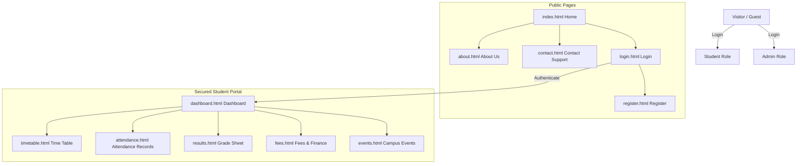
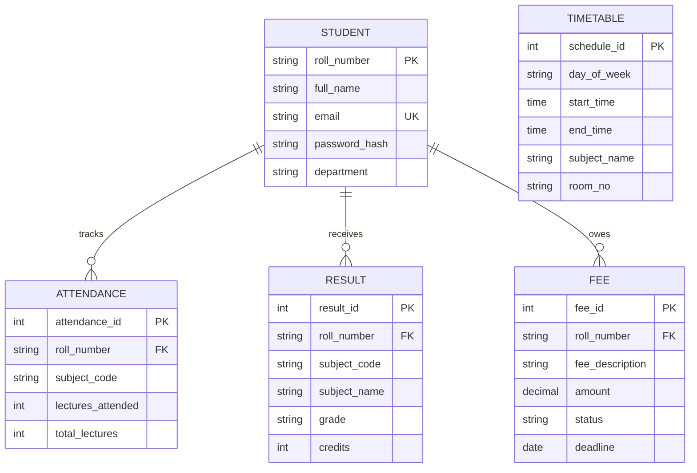

# StudentHub Portal - Design & Architecture Artifacts

This document compiles the sitemaps, wireframes, and design schemas representing the foundational architecture of the **StudentHub Portal** (Practical 1 & 2 requirements).

---

## 1. Information Architecture & Sitemap

Below is the user role hierarchy and navigation flow of the portal:



---

## 2. Low-Fidelity Responsive Wireframes

### A. Home Page (Desktop Layout vs. Mobile Layout)

#### Desktop Layout (Grid System)
```
+----------------------------------------------------------------------------------------+
|  🎓 StudentHub                        Home  About  Dashboard  Timetable  Fees  [Login] |
+----------------------------------------------------------------------------------------+
|                                                                                        |
|   EVERYTHING YOU NEED,                   +------------------------------------------+  |
|   ALL IN ONE PLACE.                      | Floating Stats Widget                    |  |
|                                          | - Attendance: 86%                        |  |
|   [Explore Dashboard] [Learn More]       | - CGPA: 8.6                              |  |
|                                          +------------------------------------------+  |
|                                                                                        |
+----------------------------------------------------------------------------------------+
|  STUDENT ESSENTIALS (Flex/Grid Row)                                                    |
|                                                                                        |
|  +------------------------+  +------------------------+  +------------------------+  |
|  | 📅 Time Table          |  | ✓ Attendance           |  | ★ Results              |  |
|  | Keep schedules in view |  | Track percentage       |  | View sem grade sheets  |  |
|  | [View Timetable ->]    |  | [Check Attendance ->]  |  | [View Results ->]      |  |
|  +------------------------+  +------------------------+  +------------------------+  |
+----------------------------------------------------------------------------------------+
|  © 2026 StudentHub                                                                     |
+----------------------------------------------------------------------------------------+
```

#### Mobile Layout (Stacked Flexbox)
```
+------------------------------------+
|  🎓 StudentHub                 [=] |  <-- Hamburger Drawer Toggle
+------------------------------------+
|                                    |
|   EVERYTHING YOU NEED,             |
|   ALL IN ONE PLACE.                |
|                                    |
|   [Explore Dashboard]              |
|   [Learn More]                     |
|                                    |
|   +----------------------------+   |
|   | Floating Stats Widget      |   |
|   | - Attendance: 86%          |   |
|   | - CGPA: 8.6                |   |
|   +----------------------------+   |
|                                    |
+------------------------------------+
|  STUDENT ESSENTIALS (Stacked)      |
|                                    |
|  +------------------------------+  |
|  | 📅 Time Table                |  |
|  | [View Timetable ->]          |  |
|  +------------------------------+  |
|  | ✓ Attendance                 |  |
|  | [Check Attendance ->]        |  |
|  +------------------------------+  |
|  | ★ Results                    |  |
|  | [View Results ->]            |  |
|  +------------------------------+  |
+------------------------------------+
|  © 2026 StudentHub                 |
+------------------------------------+
```

---

## 3. Entity-Relationship (ER) Diagram (Advanced Extension)

For future database implementation, this relational database schema maps entities, keys, and card-relationships:



---

## 4. RESTful Routing Plan (Advanced Extension)

The table below outlines API endpoints for the backend integration phase:

| Module | HTTP Method | Endpoint | Description | Request Body / Parameters |
| :--- | :--- | :--- | :--- | :--- |
| **Auth** | POST | `/api/auth/register` | Student Sign Up | `{ fullname, rollnumber, department, email, password }` |
| **Auth** | POST | `/api/auth/login` | Student Authentication | `{ email, password }` |
| **Profile** | GET | `/api/student/profile` | Fetch logged-in student info | *None (Requires Bearer Token)* |
| **Timetable**| GET | `/api/student/timetable` | Get student weekly schedule | *None (Token)* |
| **Attendance**| GET | `/api/student/attendance` | Subject-wise attendance ratios | *None (Token)* |
| **Results** | GET | `/api/student/results` | Fetch sem grade points and GPAs | *None (Token)* |
| **Fees** | GET | `/api/student/fees` | Get billing dues and history | *None (Token)* |
| **Fees** | POST | `/api/student/fees/pay` | Submit pending dues payment | `{ fee_id, payment_method }` |
| **Events** | GET | `/api/events` | List all open campus events | *None* |
| **Events** | POST | `/api/events/register` | Register student to an event | `{ event_id }` |
